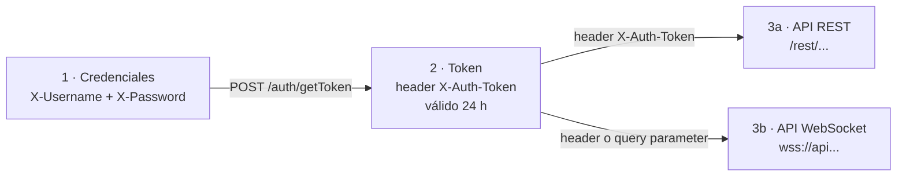

import AuthHeader from '/snippets/auth-header.mdx';

Matriz OMS API utiliza **autenticación por token**. Solicitás el token con una petición `POST` enviando tu usuario y contraseña como headers, y el servidor devuelve un token de acceso **válido por 24 horas** que debés incluir en todos los requests posteriores.

<Info>
  Matriz OMS API expone dos dominios y **cada uno requiere su propio token**, que se obtiene de la misma forma pero contra su propia URL base. Esta página documenta el dominio de **Trading** (`api`). Ver [Ambientes](/environments).
</Info>

<Note>
  Las **credenciales del entorno Demo** te las envía Soporte al completar el [relevamiento previo de homologación](/homologacion/solicitud). Las **credenciales de producción** las gestiona tu ALyC o la Mesa de Operaciones una vez aprobada la [homologación](/homologacion/proceso).
</Note>

## El flujo en un vistazo



<Steps>
  <Step title="Enviá tus credenciales" icon="right-to-bracket">
    Hacé un `POST /auth/getToken` con tu usuario y contraseña en los headers `X-Username` y `X-Password`.
  </Step>
  <Step title="Recibí el token" icon="key">
    El servidor lo devuelve en el **header** `X-Auth-Token` de la respuesta (no en el cuerpo). Es válido por **24 horas**.
  </Step>
  <Step title="Usalo en la API REST" icon="arrow-right-arrow-left">
    Enviá el header `X-Auth-Token` en cada request al dominio `api`.
  </Step>
  <Step title="Usalo en la API WebSocket" icon="bolt">
    Enviá el mismo token al abrir la conexión, como header del handshake o como query parameter. Ver [API WebSocket](/websockets/overview).
  </Step>
</Steps>

## Obtener el token de acceso (Trading)

```http
POST https://api.{urlbase}.(matrizoms|xoms).com.ar/auth/getToken
```

### Headers del request

<ParamField header="X-Username" type="string" required>
  Tu nombre de usuario.
</ParamField>

<ParamField header="X-Password" type="string" required>
  Tu contraseña.
</ParamField>

### Headers de la respuesta

<ResponseField name="X-Auth-Token" type="string" required>
  Token de acceso. Viene en los **headers** de la respuesta. Debés enviarlo en el header `X-Auth-Token` de todos los requests posteriores contra el dominio `api`. Validez: 24 horas.
</ResponseField>

<Note>
  El token **no viene en el cuerpo** de la respuesta: leelo siempre desde el header `X-Auth-Token`.
</Note>

## Probalo: login y llamada autenticada

Cada ejemplo hace el login, toma el token del header de la respuesta y lo usa para consultar la [lista de segmentos disponibles](/reference-data/segments/list). Configurá antes `MATRIZ_URLBASE`, `MATRIZ_DOMINIO`, `MATRIZ_USERNAME` y `MATRIZ_PASSWORD`.

<CodeGroup>

```python Python
# pip install requests
import os

import requests

URLBASE = os.environ["MATRIZ_URLBASE"]                    # ej.: "demo"
DOMINIO = os.environ.get("MATRIZ_DOMINIO", "matrizoms")   # "matrizoms" o "xoms"
BASE_URL = f"https://api.{URLBASE}.{DOMINIO}.com.ar"

# 1. Login: usuario y contraseña viajan como headers
login = requests.post(
    f"{BASE_URL}/auth/getToken",
    headers={
        "X-Username": os.environ["MATRIZ_USERNAME"],
        "X-Password": os.environ["MATRIZ_PASSWORD"],
    },
    timeout=10,
)
login.raise_for_status()

# 2. El token viene en el header de la respuesta (no en el cuerpo) y vale 24 horas
token = login.headers["X-Auth-Token"]

# 3. Llamada autenticada: el token va en el header X-Auth-Token
segmentos = requests.get(
    f"{BASE_URL}/rest/segment/all",
    headers={"X-Auth-Token": token},
    timeout=10,
)
segmentos.raise_for_status()
print(segmentos.json())
```

```javascript Node.js
// Node.js 18 o superior (fetch nativo, ES modules)
const URLBASE = process.env.MATRIZ_URLBASE;                 // ej.: "demo"
const DOMINIO = process.env.MATRIZ_DOMINIO ?? "matrizoms";  // "matrizoms" o "xoms"
const BASE_URL = `https://api.${URLBASE}.${DOMINIO}.com.ar`;

// 1. Login: usuario y contraseña viajan como headers
const login = await fetch(`${BASE_URL}/auth/getToken`, {
  method: "POST",
  headers: {
    "X-Username": process.env.MATRIZ_USERNAME,
    "X-Password": process.env.MATRIZ_PASSWORD,
  },
});

if (!login.ok) {
  throw new Error(`No se pudo obtener el token: HTTP ${login.status}`);
}

// 2. El token viene en el header de la respuesta (no en el cuerpo) y vale 24 horas
const token = login.headers.get("X-Auth-Token");

// 3. Llamada autenticada: el token va en el header X-Auth-Token
const segmentos = await fetch(`${BASE_URL}/rest/segment/all`, {
  headers: { "X-Auth-Token": token },
});
console.log(await segmentos.json());
```

```bash cURL
# Tip: con "curl -i" ves todos los headers de la respuesta, donde viene X-Auth-Token.
BASE_URL="https://api.$MATRIZ_URLBASE.$MATRIZ_DOMINIO.com.ar"

# 1. Login: el token llega en el header X-Auth-Token de la respuesta
MATRIZ_TOKEN=$(curl -s -D - -o /dev/null -X POST "$BASE_URL/auth/getToken" \
  -H "X-Username: $MATRIZ_USERNAME" \
  -H "X-Password: $MATRIZ_PASSWORD" \
  | awk 'tolower($1) == "x-auth-token:" { print $2 }' | tr -d '\r')

# 2. Verificá que se obtuvo el token
[ -n "$MATRIZ_TOKEN" ] || { echo "No se obtuvo el token: revisá usuario, contraseña y URL base" >&2; exit 1; }

# 3. Llamada autenticada: el token va en el header X-Auth-Token
curl "$BASE_URL/rest/segment/all" -H "X-Auth-Token: $MATRIZ_TOKEN"
```

</CodeGroup>

## Usar el token en los requests

<Tabs>
  <Tab title="API REST" icon="arrow-right-arrow-left">
    Una vez obtenido el token, envialo en el header `X-Auth-Token` de cada request al dominio `api`:

    <AuthHeader />
  </Tab>
  <Tab title="API WebSocket" icon="bolt">
    La API WebSocket usa el **mismo token** del dominio `api`. Obtenelo por REST y envialo al abrir la conexión, por cualquiera de estas dos vías:

    - **Header HTTP en el handshake** (recomendado en backends): `X-Auth-Token: <token>`.
    - **Query parameter** (útil en navegadores): `wss://api.{urlbase}.(matrizoms|xoms).com.ar/?X-Auth-Token=<token>`.

    Ejemplos completos en [API WebSocket](/websockets/overview).
  </Tab>
</Tabs>

## Validez y renovación del token

<Warning>
  El token vale **24 horas**: reutilizalo durante toda su vigencia y no pidas uno nuevo en cada request. Renovalo con margen, antes de que venza.
</Warning>

- **Reutilizá el token** durante su vigencia. No solicites un token nuevo en cada request.
- **Renovalo antes de que venza.** Pedí un token nuevo con margen, en lugar de esperar a que un request falle.
- **Gestioná un token por dominio.** Si también operás sobre `api-risk`, mantené ese token por separado.

<Accordion title="Ejemplo: cliente Python con renovación automática del token" icon="rotate">
```python
import os
import time
import requests

class MatrizClient:
    """Cliente mínimo que reutiliza el token y lo renueva antes de las 24 horas."""

    VIGENCIA_SEGUNDOS = 24 * 60 * 60
    MARGEN_SEGUNDOS = 60 * 60  # renueva una hora antes del vencimiento

    def __init__(self, urlbase: str, dominio: str = "matrizoms"):
        self.base_url = f"https://api.{urlbase}.{dominio}.com.ar"
        self._token = None
        self._emitido_en = 0.0

    def _token_vigente(self) -> str:
        edad = time.time() - self._emitido_en
        if self._token is None or edad > self.VIGENCIA_SEGUNDOS - self.MARGEN_SEGUNDOS:
            respuesta = requests.post(
                f"{self.base_url}/auth/getToken",
                headers={
                    "X-Username": os.environ["MATRIZ_USERNAME"],
                    "X-Password": os.environ["MATRIZ_PASSWORD"],
                },
                timeout=10,
            )
            respuesta.raise_for_status()
            self._token = respuesta.headers["X-Auth-Token"]
            self._emitido_en = time.time()
        return self._token

    def get(self, ruta: str, **params):
        respuesta = requests.get(
            f"{self.base_url}{ruta}",
            headers={"X-Auth-Token": self._token_vigente()},
            params=params,
            timeout=10,
        )
        respuesta.raise_for_status()
        return respuesta.json()


cliente = MatrizClient(urlbase=os.environ["MATRIZ_URLBASE"])
print(cliente.get("/rest/segment/all"))
```
</Accordion>

## Errores frecuentes

<AccordionGroup>
  <Accordion title="No recibo el token (credenciales inválidas)" icon="user-lock">
    Si el login es rechazado, la respuesta no trae el header `X-Auth-Token`. Revisá:

    - Que `X-Username` y `X-Password` estén escritos tal cual y viajen como **headers** (no como parámetros ni en el cuerpo).
    - Que tu usuario esté habilitado para el ambiente al que te conectás.
    - Que la URL base (`{urlbase}` y dominio) sea la correcta. Ver [Ambientes](/environments).

    Detectá el rechazo antes de leer el token: `raise_for_status()` en Python o `respuesta.ok` en Node.js, como en los ejemplos de arriba.
  </Accordion>

  <Accordion title="El token venció (pasaron 24 horas)" icon="clock">
    Un token vencido ya no sirve: pedí uno nuevo con `POST /auth/getToken` y reemplazalo en tus requests. Para no llegar a ese punto, renovalo con margen (ver el cliente con renovación automática más arriba).

    En una conexión WebSocket, **renová el token antes de reconectar** si está cerca de cumplir sus 24 horas.
  </Accordion>

  <Accordion title="Uso un token del dominio equivocado" icon="shield-halved">
    El token obtenido en `api` no sirve para `api-risk`, y viceversa. Pedí cada token contra la URL base del dominio en el que vas a operar y no los mezcles.
  </Accordion>

  <Accordion title="Recibo “Access Denied”" icon="lock">
    ```json
    {
      "status": "ERROR",
      "message": "Access Denied"
    }
    ```

    Aparece al invocar un método al que tu usuario no tiene acceso. Verificá que el token sea del dominio correcto, que esté vigente y que tu perfil tenga permisos para el método. Ver [Errores](/reference/errors).
  </Accordion>

  <Accordion title="No encuentro el token en la respuesta" icon="magnifying-glass">
    El token **no viene en el cuerpo**: viene en el header `X-Auth-Token` de la respuesta. En cURL usá `-i` para ver los headers; en Python, `respuesta.headers["X-Auth-Token"]`; en Node.js, `respuesta.headers.get("X-Auth-Token")`.
  </Accordion>

  <Accordion title="El WebSocket no abre la conexión" icon="bolt">
    Verificá que envíes el token del dominio `api`, vigente, por alguna de las dos vías: header `X-Auth-Token` en el handshake o query parameter `?X-Auth-Token=<token>`. Los navegadores no permiten headers personalizados en el WebSocket nativo: usá el query parameter y codificá el token con `encodeURIComponent`. Ver [API WebSocket](/websockets/overview).
  </Accordion>
</AccordionGroup>

{/* [PENDIENTE] Documentar el código HTTP y el cuerpo exactos de la respuesta ante credenciales inválidas y ante token vencido (por ejemplo, si responde 401 Unauthorized). Ninguna de las tres fuentes lo define, por eso las secciones de errores de arriba describen causas y soluciones sin afirmar un código. */}

## Dominio de Riesgo (`api-risk`)

<Warning>
  El dominio `api-risk.{urlbase}.(matrizoms|xoms).com.ar` es **exclusivo para administradores de ALyC** con credenciales habilitadas. Usa el mismo mecanismo de autenticación, pero con su propia URL y su propio token. La documentación completa está disponible en la sección restringida de Risk API para usuarios con ese perfil.
</Warning>

## Buenas prácticas de seguridad

- **No incluyas credenciales en el código.** Usá variables de entorno o un gestor de secretos.
- **Tratá el token como una credencial.** No lo registres en logs ni lo compartas entre usuarios o sistemas.
- **Usá siempre HTTPS** y la URL base que te fue asignada.
- **Separá las credenciales por ambiente**: pruebas y producción no deberían compartir usuario ni token.

## Siguientes pasos

<CardGroup cols={3}>
  <Card title="Guía rápida" icon="rocket" href="/quickstart">
    Tu primera orden verificada, de punta a punta.
  </Card>

  <Card title="Ambientes" icon="server" href="/environments">
    Cómo se arma la URL base y cómo pasar a producción.
  </Card>

  <Card title="API WebSocket" icon="bolt" href="/websockets/overview">
    Conexión en tiempo real con el mismo token.
  </Card>
</CardGroup>
