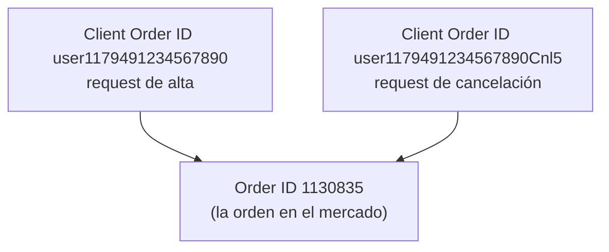

Dos términos que suelen confundirse, pero que representan cosas distintas, son el **Client Order ID** y el **Order ID**. Entender la diferencia es clave para consultar correctamente la API e interpretar sus respuestas.

## Los dos conceptos

<CardGroup cols={2}>
  <Card title="Client Order ID (clOrdId)" icon="paper-plane">
    Identifica un **request puntual** hecho al mercado: un alta, un reemplazo o una cancelación. Cada request tiene su propio Client Order ID.
  </Card>
  <Card title="Order ID (orderId)" icon="file-lines">
    Identifica **la orden en el mercado**. Puede tener asociados varios Client Order IDs, uno por cada request que se le hizo.
  </Card>
</CardGroup>

Por ejemplo, cuando se da de alta una orden se envía un request de alta, con un Client Order ID específico. Si después se cancela esa orden, se envía un request de cancelación, con **otro** Client Order ID. Para el mercado son dos requests distintos, aunque ambos están asociados al **mismo Order ID**.

## Ejemplo paso a paso

| Paso | Acción | Client Order ID devuelto | Order ID |
| --- | --- | --- | --- |
| 1 | Alta de la orden (`newSingleOrder`) | `user1179491234567890` | `1130835` |
| 2 | Cancelación (`cancelById` con `clOrdId=user1179491234567890`) | `user1179491234567890Cnl5` | `1130835` |

<Note>
  Los valores son ilustrativos: no construyas ni interpretes Client Order IDs a partir de su formato. Usá siempre el valor que devuelve la API.
</Note>

## Dónde aparece cada ID

Las APIs de ingreso y cancelación de órdenes devuelven el Client Order ID del request (en REST, en el campo `order.clientId`). **Con ese dato vas a poder hacer la mayoría de las consultas.**

| ID | Qué identifica | Dónde lo obtenés | Dónde lo usás |
| --- | --- | --- | --- |
| `clOrdId` | Un request (alta, reemplazo o cancelación) | `order.clientId` de las respuestas REST; `clOrdId` de los Execution Reports | Consultas por Client Order ID, reemplazo y cancelación (`clientId` en WebSocket) |
| `orderId` | La orden en el mercado | Consultas de estado y Execution Reports. Llega en `null` si la orden fue rechazada o todavía no llegó al mercado. | Agrupar todos los requests de una misma orden |
| `wsClOrdId` | Tu identificador propio de una orden WebSocket | Lo generás vos al enviar el mensaje `no` | Reconocer la orden en el **primer** Execution Report |
| `execId` | Una ejecución | Consultas de estado y Execution Reports | [Estado de orden por Execution ID](/order-routing/status/by-execution-id) |

## Qué consulta usar

| Querés saber… | Usá | Con |
| --- | --- | --- |
| El estado actual de un request | [Último estado por Client Order ID](/order-routing/status/last-by-client-order-id) | `clOrdId` |
| Todos los estados de un request | [Todos los estados por Client Order ID](/order-routing/status/history-by-client-order-id) | `clOrdId` |
| El último estado de cada request de una cuenta | [Estado de todas las órdenes por cuenta](/order-routing/status/all-by-account) | Cuenta |
| Qué orden participó en una operación | [Estado de orden por Execution ID](/order-routing/status/by-execution-id) | `execId` |

<Warning>
  El historial de un request de **alta** no incluye el estado `CANCELLED`: ese estado queda asociado al Client Order ID del request de **cancelación**. Para confirmar una cancelación, consultá con el `clientId` que devolvió la cancelación.
</Warning>

## El tercer identificador: wsClOrdId

En la API WebSocket no hay respuesta inmediata al enviar una orden. Por eso existe el campo opcional **`wsClOrdId`**: un identificador que generás vos y que llega **solo en el primer Execution Report**, junto con el `clOrdId` asignado. A partir de ahí, seguí la orden por su `clOrdId`. Ver [Reglas de wsClOrdId](/websockets/orders/new-order#reglas-de-wsclordid).
