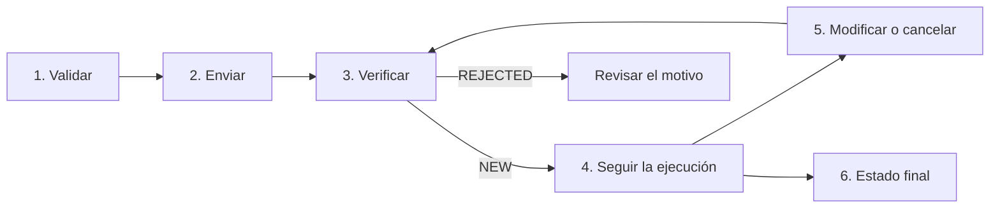
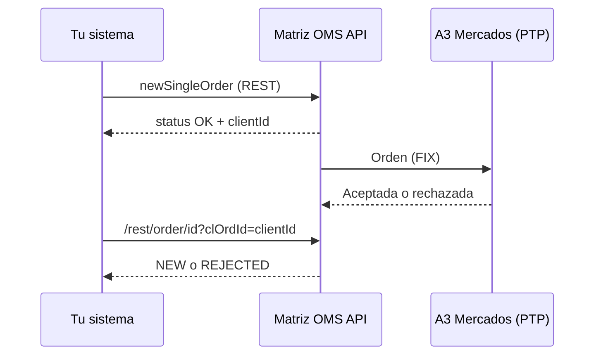

Una integración de trading robusta no termina al enviar la orden: tiene que **validarla antes**, **confirmar que el mercado la aceptó**, **seguir su ejecución** y **resolver los casos de error**. Esta guía recorre cada etapa y te indica qué método usar en cada una.

## 1. Validar antes de enviar

Consultá la [descripción detallada del instrumento](/reference-data/instruments/detail) y validá del lado de tu sistema:

| Validación | Campo del instrumento |
| --- | --- |
| El precio está dentro de los límites | `lowLimitPrice`, `highLimitPrice` |
| El precio respeta el tick | `minPriceIncrement` (o `tickPriceRanges` si el tick es dinámico) |
| La cantidad está dentro de los límites | `minTradeVol`, `maxTradeVol` |
| El tipo de orden está soportado | `orderTypes` |
| La vigencia está soportada | `timesInForce` |

<Tip>
  Cacheá el detalle de los instrumentos que operás (por ejemplo, al inicio de la rueda) en lugar de consultarlo antes de cada orden.
</Tip>

## 2. Enviar la orden

| Interfaz | Método | Qué recibís |
| --- | --- | --- |
| REST | [`GET /rest/order/newSingleOrder`](/order-routing/new-order) | Respuesta inmediata con `order.clientId` y `order.proprietary`. |
| WebSocket | [Mensaje `no`](/websockets/orders/new-order) | Nada directo: el resultado llega por Execution Report (`or`). |

<Warning>
  Recordá el tipo de dato de la cuenta: **entero** en REST (`account=30`) y **texto** en WebSocket (`"account": "30"`).
</Warning>

## 3. Verificar que el mercado la aceptó

Un `"status": "OK"` en REST solo confirma que el request fue **recibido**. Consultá el estado de la orden:

- **REST:** [Último estado por Client Order ID](/order-routing/status/last-by-client-order-id) con el `clientId` devuelto.
- **WebSocket:** esperá el Execution Report de la orden. Si enviaste `wsClOrdId`, el primer reporte lo incluye junto con el `clOrdId` asignado.

El resultado puede ser `NEW` (aceptada) o `REJECTED` (rechazada, con el motivo en `text`).

## 4. Seguir la ejecución

| Necesitás… | Usá |
| --- | --- |
| Enterarte de cada cambio al instante | [Execution Reports por WebSocket](/websockets/orders/subscribe-execution-reports) |
| Ver las órdenes vivas de una cuenta | [Órdenes activas por cuenta](/order-routing/status/actives-by-account) |
| Ver lo operado | [Órdenes operadas por cuenta](/order-routing/status/filled-by-account) |
| Identificar la orden de una ejecución | [Estado de orden por Execution ID](/order-routing/status/by-execution-id) |

Para seguir lo operado, usá `cumQty` (acumulado), `leavesQty` (remanente), `lastQty` / `lastPx` (última operación) y `avgPx` (precio promedio).

<Tip>
  Si necesitás seguir muchas órdenes, preferí los **Execution Reports por WebSocket** antes que consultar el estado por REST en forma repetida.
</Tip>

## 5. Modificar o cancelar

| Acción | REST | WebSocket |
| --- | --- | --- |
| Reemplazar precio y cantidad | [`replaceById`](/order-routing/replace-order) | No disponible |
| Cancelar | [`cancelById`](/order-routing/cancel-order) | [Mensaje `co`](/websockets/orders/cancel-order) |

Cada reemplazo o cancelación es un **request nuevo**, con su propio Client Order ID, asociado al mismo Order ID. Después de enviarlo, **volvé a verificar** el estado (etapa 3). Ver [Client Order ID vs. Order ID](/guides/client-order-id-vs-order-id).

<Warning>
  El parámetro `cancelPrevious=true` de `newSingleOrder` cancela las órdenes previas del **mismo contrato, cuenta y lado** antes de ingresar la nueva. Usalo solo si es exactamente lo que necesitás.
</Warning>

## 6. Estados finales

Una orden termina en `FILLED` (operada totalmente), `CANCELLED` (cancelada) o `REJECTED` (rechazada). Ver la tabla completa en [Estados de una orden](/reference/order-statuses).

## Buenas prácticas

<AccordionGroup>
  <Accordion title="No reenvíes una orden ante un timeout" icon="clock">
    Si un request de alta no responde a tiempo, la orden puede haber llegado igual al mercado. Antes de reenviarla, consultá las [órdenes activas](/order-routing/status/actives-by-account) de la cuenta (o el estado por Client Order ID, si lo tenés) para no duplicarla.
  </Accordion>
  <Accordion title="Identificá tus órdenes en WebSocket" icon="fingerprint">
    Enviá un `wsClOrdId` propio en cada orden y asocialo con el `clOrdId` del primer Execution Report. La API no valida que sea único: generalo de forma que lo sea en tu sistema.
  </Accordion>
  <Accordion title="Reconciliá después de una desconexión" icon="rotate">
    Si se cortó la conexión WebSocket, los Execution Reports emitidos mientras estabas desconectado pueden haberse perdido. Al reconectar, consultá las órdenes activas por REST o suscribite con `snapshotOnlyActive`.
  </Accordion>
  <Accordion title="Registrá los identificadores" icon="clipboard-list">
    Guardá en tus logs `clOrdId`, `wsClOrdId`, `orderId` y `execId` con su timestamp. Son los datos que te va a pedir [Soporte](/support) para investigar un incidente.
  </Accordion>
</AccordionGroup>

{/* [PENDIENTE] Confirmar que no existe un mensaje de reemplazo por WebSocket (ninguna fuente lo documenta) y cómo se informa la expiración de órdenes DAY y GTD. */}
