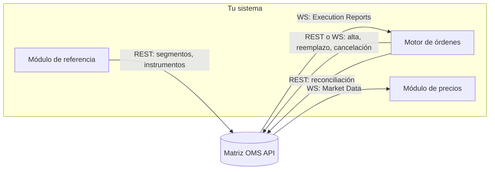

Matriz OMS API ofrece dos interfaces que **conviven y se complementan**: la **API REST** (sincrónica: request y respuesta) y la **API WebSocket** (asíncrona: mensajes en ambos sentidos, sin polling).

## Comparación

| | API REST | API WebSocket |
| --- | --- | --- |
| **Modelo** | Sincrónico: cada request tiene su respuesta | Asíncrono: el servidor envía mensajes cuando algo cambia |
| **Conexión** | Un request HTTPS por operación | Una conexión persistente `wss://` |
| **Autenticación** | Header `X-Auth-Token` en cada request | `X-Auth-Token` al abrir la conexión (header o query parameter) |
| **Cuenta** | Entero (`account=30`) | Texto (`"account": "30"`) |
| **Resultado de una orden** | Respuesta inmediata con `clientId`; el estado se consulta aparte | Llega por Execution Report (`or`) |
| **Market Data** | Último dato disponible al momento del request | Actualizaciones en tiempo real cada vez que cambia |

## Funcionalidades por interfaz

| Funcionalidad | REST | WebSocket |
| --- | --- | --- |
| Segmentos e instrumentos | Sí | — |
| Ingresar una orden | Sí | Sí (`no`) |
| Reemplazar una orden | Sí | — |
| Cancelar una orden | Sí | Sí (`co`) |
| Consultar el estado de órdenes | Sí | — |
| Recibir cambios de estado al instante | — | Sí (Execution Reports) |
| Market Data: último dato disponible | Sí | — |
| Market Data en tiempo real | — | Sí (`smd` / `Md`) |
| Market Data histórica (trades) | Sí | — |

{/* [PENDIENTE] Confirmar que no existen mensajes WebSocket para reemplazar órdenes ni para consultar datos de referencia. */}

## Cuándo usar cada una

<CardGroup cols={2}>
  <Card title="Usá REST para…" icon="arrow-right-arrow-left">
    - Datos de referencia: segmentos e instrumentos.
    - Operatoria de bajo volumen o disparada por un usuario.
    - Reemplazar órdenes.
    - Consultas puntuales de estado y reconciliación.
    - Market Data histórica.
  </Card>
  <Card title="Usá WebSocket para…" icon="bolt">
    - Precios en tiempo real.
    - Enterarte al instante de cada cambio en tus órdenes.
    - Operatoria de alta frecuencia o algorítmica.
    - Pantallas que se actualizan solas.
  </Card>
</CardGroup>

<Info>
  Las **cotizaciones en tiempo real requieren WebSocket**. Consultar Market Data por REST en forma repetida no reemplaza a una suscripción.
</Info>

## Arquitectura híbrida recomendada

La mayoría de las integraciones combinan ambas interfaces:

1. **Al iniciar:** obtené el token y cargá los datos de referencia por REST.
2. **Conexión WebSocket:** suscribite a Execution Reports (`os`) y a Market Data (`smd`).
3. **Operación:** enviá órdenes por la interfaz que prefieras, reemplazá por REST y procesá los Execution Reports a medida que llegan.
4. **Reconciliación:** al iniciar y después de cada reconexión, consultá las órdenes activas por REST.

<Tip>
  Usá el **mismo token** del dominio `api` para REST y WebSocket. Renovalo antes de que cumpla 24 horas, y reconectá el WebSocket con el token nuevo cuando corresponda.
</Tip>
