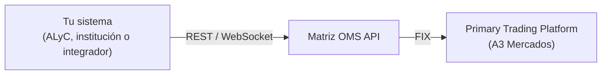

import RevisarVigencia from '/snippets/revisar-vigencia.mdx';

<div className="mx-hero">
  <div className="mx-hero__badges">
    <span className="mx-badge mx-badge--rest"><span className="mx-badge__dot" />REST API</span>
    <span className="mx-badge mx-badge--ws"><span className="mx-badge__dot mx-badge__dot--pulse" />WebSocket Low-Latency</span>
    <span className="mx-badge mx-badge--dma"><span className="mx-badge__dot" />DMA / OMS</span>
  </div>
  <p className="mx-hero__title">Infraestructura de mercado, en una API simple.</p>
  <p className="mx-hero__lead">Matriz OMS API traduce el estándar <strong>FIX</strong> de Primary Trading Platform (PTP) de <strong>A3 Mercados</strong> a Web Services <strong>REST</strong> y <strong>WebSocket</strong>. Ruteá órdenes, recibí Execution Reports y consumí Market Data en tiempo real con menos esfuerzo y menos costo de desarrollo.</p>
  <div className="mx-hero__actions">
    <a className="mx-btn mx-btn--primary" href="/quickstart">Guía rápida →</a>
    <a className="mx-btn mx-btn--ghost" href="/environments">Ambientes</a>
    <a className="mx-btn mx-btn--ghost" href="/authentication">Autenticación</a>
  </div>
  <div className="mx-hero__stats">
    <div className="mx-stat"><span className="mx-stat__label">Interfaces</span><span className="mx-stat__value">REST · WebSocket</span></div>
    <div className="mx-stat"><span className="mx-stat__label">Autenticación</span><span className="mx-stat__value">X-Auth-Token · 24 h</span></div>
    <div className="mx-stat"><span className="mx-stat__label">Mercado</span><span className="mx-stat__value">FIX → PTP · A3 Mercados</span></div>
  </div>
</div>

## Flujos principales

<div className="mx-bento">
  <div className="mx-bento__item mx-bento__item--wide mx-bento__item--orders">
    <Card title="Order Routing" icon="paper-plane" href="/order-routing/new-order">
      Ingresá, reemplazá y cancelá órdenes LIMIT o MARKET con vigencia DAY, IOC, FOK o GTD, incluidas las iceberg. Después, verificá su estado por Client Order ID, cuenta o Execution ID.

      <span className="mx-chip">newSingleOrder</span> <span className="mx-chip">replaceById</span> <span className="mx-chip">cancelById</span> <span className="mx-chip">order/actives</span>
    </Card>
  </div>
  <div className="mx-bento__item mx-bento__item--md">
    <Card title="Market Data" icon="chart-line" href="/market-data/snapshot">
      Consultá el último dato de mercado de cualquier instrumento (puntas, último precio, ajuste e interés abierto) y la historia de operaciones.

      <span className="mx-chip">marketdata/get</span> <span className="mx-chip">getTrades</span>
    </Card>
  </div>
  <div className="mx-bento__item mx-bento__item--ws">
    <Card title="WebSockets en tiempo real" icon="bolt" href="/websockets/overview">
      Suscribite a Market Data y a Execution Reports sin polling. Enviá y cancelá órdenes por una conexión persistente.

      <span className="mx-chip">smd</span> <span className="mx-chip">os</span> <span className="mx-chip">no</span> <span className="mx-chip">co</span>
    </Card>
  </div>
  <div className="mx-bento__item mx-bento__item--wide mx-bento__item--risk">
    <Card title="Risk API" icon="shield-halved" href="/risk/overview">
      Consultá posiciones, el detalle de posiciones y el reporte de cuenta (márgenes, garantías y disponible) sobre el Risk Manager.

      <span className="mx-chip mx-chip--lock">Exclusivo administradores de ALyC</span> <span className="mx-chip">api-risk</span>
    </Card>
  </div>
</div>

<CardGroup cols={3}>
  <Card title="Datos de referencia" icon="layer-group" href="/reference-data/segments/list">
    Segmentos, instrumentos, filtros por código CFI y por segmento.
  </Card>
  <Card title="Ciclo de vida de una orden" icon="arrows-spin" href="/guides/order-lifecycle">
    Validá, enviá, verificá y seguí cada orden de forma robusta.
  </Card>
  <Card title="REST o WebSocket" icon="code-compare" href="/guides/rest-vs-websocket">
    Qué ofrece cada interfaz y cómo combinarlas.
  </Card>
</CardGroup>

## La plataforma en acción

Así se ve el front DMA de Matriz OMS operando sobre la misma infraestructura que expone esta API.

<div className="demo-video-grid">
  <div className="demo-video-frame">
    <div className="demo-video-frame__bar">
      <span className="demo-video-frame__dots"><span /><span /><span /></span>
      <span className="demo-video-frame__title">Workspace DMA · multi-widgets</span>
      <span className="demo-video-frame__status"><span className="demo-video-frame__pulse" />Demo</span>
    </div>
    <video className="demo-video demo-video--light" src="/plataforma/WidgetsLight.mp4" autoPlay loop muted playsInline aria-label="Demo del workspace DMA con múltiples widgets, modo claro" />
    <video className="demo-video demo-video--dark" src="/plataforma/WidgetsDark.mp4" autoPlay loop muted playsInline aria-label="Demo del workspace DMA con múltiples widgets, modo oscuro" />
  </div>
  <div className="demo-video-frame">
    <div className="demo-video-frame__bar">
      <span className="demo-video-frame__dots"><span /><span /><span /></span>
      <span className="demo-video-frame__title">Grilla de favoritos · Market Data en tiempo real</span>
      <span className="demo-video-frame__status"><span className="demo-video-frame__pulse" />Demo</span>
    </div>
    <video className="demo-video demo-video--light" src="/plataforma/FavsLight.mp4" autoPlay loop muted playsInline aria-label="Demo de la grilla de favoritos con Market Data en tiempo real, modo claro" />
    <video className="demo-video demo-video--dark" src="/plataforma/FrontMDdark.mp4" autoPlay loop muted playsInline aria-label="Demo de la grilla de favoritos con Market Data en tiempo real, modo oscuro" />
  </div>
</div>

## Probalo en minutos

Cada pestaña es un flujo completo y listo para copiar. Configurá antes estas variables de entorno: `MATRIZ_URLBASE` (ej.: `demo`), `MATRIZ_DOMINIO` (`matrizoms` o `xoms`), `MATRIZ_USERNAME`, `MATRIZ_PASSWORD` y, para los ejemplos que no piden token, `MATRIZ_TOKEN`.

<div className="mx-terminal">

<Tabs>
  <Tab title="Quickstart REST" icon="rocket">
    Token, segmentos y último dato de mercado de `DLR/DIC26` en un solo script.

    <CodeGroup>
    ```python Python
    # pip install requests
    import os

    import requests

    # URL base de tu ambiente: api.{urlbase}.(matrizoms|xoms).com.ar
    BASE_URL = f"https://api.{os.environ['MATRIZ_URLBASE']}.{os.environ.get('MATRIZ_DOMINIO', 'matrizoms')}.com.ar"

    # 1. Token de acceso: llega en el header X-Auth-Token y vale 24 horas
    auth = requests.post(
        f"{BASE_URL}/auth/getToken",
        headers={
            "X-Username": os.environ["MATRIZ_USERNAME"],
            "X-Password": os.environ["MATRIZ_PASSWORD"],
        },
        timeout=10,
    )
    auth.raise_for_status()
    HEADERS = {"X-Auth-Token": auth.headers["X-Auth-Token"]}

    # 2. Segmentos de negociación disponibles
    segmentos = requests.get(f"{BASE_URL}/rest/segment/all", headers=HEADERS, timeout=10).json()
    print("Segmentos:", [s["marketSegmentId"] for s in segmentos["segments"]])

    # 3. Último dato de mercado: puntas y último precio
    md = requests.get(
        f"{BASE_URL}/rest/marketdata/get",
        headers=HEADERS,
        params={"marketId": "ROFX", "symbol": "DLR/DIC26", "entries": "BI,OF,LA"},
        timeout=10,
    ).json()
    print("DLR/DIC26:", md["marketData"])
    ```

    ```javascript Node.js
    // Node.js 18 o superior (fetch nativo, ES modules)
    // URL base de tu ambiente: api.{urlbase}.(matrizoms|xoms).com.ar
    const BASE_URL = `https://api.${process.env.MATRIZ_URLBASE}.${process.env.MATRIZ_DOMINIO ?? "matrizoms"}.com.ar`;

    // 1. Token de acceso: llega en el header X-Auth-Token y vale 24 horas
    const auth = await fetch(`${BASE_URL}/auth/getToken`, {
      method: "POST",
      headers: {
        "X-Username": process.env.MATRIZ_USERNAME,
        "X-Password": process.env.MATRIZ_PASSWORD,
      },
    });
    if (!auth.ok) throw new Error(`No se pudo obtener el token: HTTP ${auth.status}`);
    const HEADERS = { "X-Auth-Token": auth.headers.get("X-Auth-Token") };

    // 2. Segmentos de negociación disponibles
    const segmentos = await (await fetch(`${BASE_URL}/rest/segment/all`, { headers: HEADERS })).json();
    console.log("Segmentos:", segmentos.segments.map((s) => s.marketSegmentId));

    // 3. Último dato de mercado: puntas y último precio
    const params = new URLSearchParams({ marketId: "ROFX", symbol: "DLR/DIC26", entries: "BI,OF,LA" });
    const md = await (await fetch(`${BASE_URL}/rest/marketdata/get?${params}`, { headers: HEADERS })).json();
    console.log("DLR/DIC26:", md.marketData);
    ```

    ```bash cURL
    # URL base de tu ambiente
    BASE_URL="https://api.$MATRIZ_URLBASE.$MATRIZ_DOMINIO.com.ar"

    # 1. Token de acceso: copiá el valor del header X-Auth-Token de la respuesta
    curl -i -X POST "$BASE_URL/auth/getToken" \
      -H "X-Username: $MATRIZ_USERNAME" \
      -H "X-Password: $MATRIZ_PASSWORD"

    # 2. Segmentos de negociación disponibles
    curl "$BASE_URL/rest/segment/all" -H "X-Auth-Token: $MATRIZ_TOKEN"

    # 3. Último dato de mercado: puntas y último precio
    curl --get "$BASE_URL/rest/marketdata/get" \
      -H "X-Auth-Token: $MATRIZ_TOKEN" \
      --data-urlencode "marketId=ROFX" \
      --data-urlencode "symbol=DLR/DIC26" \
      --data-urlencode "entries=BI,OF,LA"
    ```
    </CodeGroup>
  </Tab>
  <Tab title="Suscripción WebSocket" icon="bolt">
    Conexión `wss://` con el token en el handshake, suscripción a Market Data de `DLR/DIC26` y a Execution Reports de la cuenta `"30"`.

    <CodeGroup>
    ```python Python
    # pip install "websockets>=14"
    import asyncio
    import json
    import os

    import websockets

    WS_URL = f"wss://api.{os.environ['MATRIZ_URLBASE']}.{os.environ.get('MATRIZ_DOMINIO', 'matrizoms')}.com.ar/"
    TOKEN = os.environ["MATRIZ_TOKEN"]  # obtenido con POST /auth/getToken


    async def main() -> None:
        # El token viaja en el header X-Auth-Token del handshake
        async with websockets.connect(WS_URL, additional_headers={"X-Auth-Token": TOKEN}) as ws:
            # Market Data en tiempo real: puntas y último precio
            await ws.send(json.dumps({
                "type": "smd",
                "level": 1,
                "entries": ["BI", "OF", "LA"],
                "products": [{"symbol": "DLR/DIC26", "marketId": "ROFX"}],
                "depth": 1,
            }))
            # Execution Reports de la cuenta "30" (la cuenta va como texto)
            await ws.send(json.dumps({"type": "os", "account": {"id": "30"}}))

            async for crudo in ws:
                mensaje = json.loads(crudo)
                if mensaje.get("type") == "Md":
                    print("Market Data:", mensaje["instrumentId"]["symbol"], mensaje["marketData"])
                elif mensaje.get("type") == "or":
                    reporte = mensaje["orderReport"]
                    print("Execution Report:", reporte["clOrdId"], reporte["status"])


    asyncio.run(main())
    ```

    ```javascript Node.js
    // npm install ws   ·   Node.js 18 o superior (ES modules)
    import WebSocket from "ws";

    const WS_URL = `wss://api.${process.env.MATRIZ_URLBASE}.${process.env.MATRIZ_DOMINIO ?? "matrizoms"}.com.ar/`;

    // El token viaja en el header X-Auth-Token del handshake
    const ws = new WebSocket(WS_URL, { headers: { "X-Auth-Token": process.env.MATRIZ_TOKEN } });

    ws.on("open", () => {
      // Market Data en tiempo real: puntas y último precio
      ws.send(JSON.stringify({
        type: "smd",
        level: 1,
        entries: ["BI", "OF", "LA"],
        products: [{ symbol: "DLR/DIC26", marketId: "ROFX" }],
        depth: 1,
      }));
      // Execution Reports de la cuenta "30" (la cuenta va como texto)
      ws.send(JSON.stringify({ type: "os", account: { id: "30" } }));
    });

    ws.on("message", (datos) => {
      const mensaje = JSON.parse(datos.toString());
      if (mensaje.type === "Md") {
        console.log("Market Data:", mensaje.instrumentId.symbol, mensaje.marketData);
      } else if (mensaje.type === "or") {
        console.log("Execution Report:", mensaje.orderReport.clOrdId, mensaje.orderReport.status);
      }
    });

    ws.on("error", (error) => console.error("Error de WebSocket:", error.message));
    ```

    ```bash CLI (websocat)
    # cURL no es un cliente WebSocket interactivo: usamos websocat (github.com/vi/websocat).
    # -n mantiene la conexión abierta después de enviar la suscripción.
    echo '{"type":"smd","level":1,"entries":["BI","OF","LA"],"products":[{"symbol":"DLR/DIC26","marketId":"ROFX"}],"depth":1}' \
      | websocat -n -H "X-Auth-Token: $MATRIZ_TOKEN" "wss://api.$MATRIZ_URLBASE.$MATRIZ_DOMINIO.com.ar/"
    ```
    </CodeGroup>
  </Tab>
  <Tab title="Autenticación Token" icon="key">
    Un token por dominio, válido 24 horas: pedilo una vez, reutilizalo y renovalo antes de que venza.

    <CodeGroup>
    ```python Python
    # pip install requests
    import os
    import time

    import requests

    BASE_URL = f"https://api.{os.environ['MATRIZ_URLBASE']}.{os.environ.get('MATRIZ_DOMINIO', 'matrizoms')}.com.ar"
    VIGENCIA = 24 * 60 * 60   # 24 horas
    MARGEN = 60 * 60          # renueva una hora antes

    _token, _emitido = None, 0.0


    def token_vigente() -> str:
        """Devuelve un token válido, pidiendo uno nuevo solo cuando hace falta."""
        global _token, _emitido
        if _token is None or time.time() - _emitido > VIGENCIA - MARGEN:
            r = requests.post(
                f"{BASE_URL}/auth/getToken",
                headers={
                    "X-Username": os.environ["MATRIZ_USERNAME"],
                    "X-Password": os.environ["MATRIZ_PASSWORD"],
                },
                timeout=10,
            )
            r.raise_for_status()
            _token, _emitido = r.headers["X-Auth-Token"], time.time()  # el token viene en el header
        return _token


    # Usalo en cada request REST
    r = requests.get(f"{BASE_URL}/rest/segment/all", headers={"X-Auth-Token": token_vigente()}, timeout=10)
    print(r.json()["status"])
    ```

    ```javascript Node.js
    // Node.js 18 o superior (fetch nativo, ES modules)
    const BASE_URL = `https://api.${process.env.MATRIZ_URLBASE}.${process.env.MATRIZ_DOMINIO ?? "matrizoms"}.com.ar`;
    const VIGENCIA_MS = 24 * 60 * 60 * 1000; // 24 horas
    const MARGEN_MS = 60 * 60 * 1000;        // renueva una hora antes

    let token = null;
    let emitido = 0;

    // Devuelve un token válido, pidiendo uno nuevo solo cuando hace falta
    async function tokenVigente() {
      if (!token || Date.now() - emitido > VIGENCIA_MS - MARGEN_MS) {
        const r = await fetch(`${BASE_URL}/auth/getToken`, {
          method: "POST",
          headers: {
            "X-Username": process.env.MATRIZ_USERNAME,
            "X-Password": process.env.MATRIZ_PASSWORD,
          },
        });
        if (!r.ok) throw new Error(`No se pudo obtener el token: HTTP ${r.status}`);
        token = r.headers.get("X-Auth-Token"); // el token viene en el header
        emitido = Date.now();
      }
      return token;
    }

    // Usalo en cada request REST
    const r = await fetch(`${BASE_URL}/rest/segment/all`, {
      headers: { "X-Auth-Token": await tokenVigente() },
    });
    console.log((await r.json()).status);
    ```

    ```bash cURL
    # -i muestra los headers: el token viene en X-Auth-Token
    curl -i -X POST "https://api.$MATRIZ_URLBASE.$MATRIZ_DOMINIO.com.ar/auth/getToken" \
      -H "X-Username: $MATRIZ_USERNAME" \
      -H "X-Password: $MATRIZ_PASSWORD"

    # Guardalo y usalo en cada request (válido 24 horas)
    export MATRIZ_TOKEN="<valor de X-Auth-Token>"
    curl "https://api.$MATRIZ_URLBASE.$MATRIZ_DOMINIO.com.ar/rest/segment/all" \
      -H "X-Auth-Token: $MATRIZ_TOKEN"
    ```
    </CodeGroup>
  </Tab>
  <Tab title="Flujo de Orden DMA" icon="paper-plane">
    Alta de una orden LIMIT de `DLR/DIC26` a `1596.0` y verificación de su estado. La cuenta es un **entero** en REST (`account=30`).

    <CodeGroup>
    ```python Python
    # pip install requests
    import os
    import time

    import requests

    BASE_URL = f"https://api.{os.environ['MATRIZ_URLBASE']}.{os.environ.get('MATRIZ_DOMINIO', 'matrizoms')}.com.ar"
    HEADERS = {"X-Auth-Token": os.environ["MATRIZ_TOKEN"]}


    def verificar(r: requests.Response) -> dict:
        r.raise_for_status()
        datos = r.json()
        if datos.get("status") == "ERROR":
            raise RuntimeError(datos.get("description") or datos.get("message"))
        return datos


    # 1. Alta de la orden (el método es GET y los datos van como parámetros)
    alta = verificar(requests.get(
        f"{BASE_URL}/rest/order/newSingleOrder",
        headers=HEADERS,
        params={
            "marketId": "ROFX", "symbol": "DLR/DIC26", "side": "BUY",
            "ordType": "LIMIT", "timeInForce": "DAY",
            "orderQty": 1, "price": 1596.0, "account": 30,  # cuenta: entero en REST
        },
        timeout=10,
    ))["order"]
    print("Recibida. clOrdId:", alta["clientId"])

    # 2. "status": "OK" solo confirma la recepción: verificá el estado real
    for _ in range(5):
        estado = verificar(requests.get(
            f"{BASE_URL}/rest/order/id",
            headers=HEADERS,
            params={"clOrdId": alta["clientId"], "proprietary": alta["proprietary"]},
            timeout=10,
        ))["order"]
        if estado["status"] != "PENDING_NEW":
            break
        time.sleep(0.5)

    print("Estado:", estado["status"], "|", estado.get("text"))  # NEW o REJECTED
    ```

    ```javascript Node.js
    // Node.js 18 o superior (fetch nativo, ES modules)
    const BASE_URL = `https://api.${process.env.MATRIZ_URLBASE}.${process.env.MATRIZ_DOMINIO ?? "matrizoms"}.com.ar`;
    const HEADERS = { "X-Auth-Token": process.env.MATRIZ_TOKEN };

    async function verificar(r) {
      if (!r.ok) throw new Error(`HTTP ${r.status}`);
      const datos = await r.json();
      if (datos.status === "ERROR") throw new Error(datos.description || datos.message);
      return datos;
    }

    // 1. Alta de la orden (el método es GET y los datos van como parámetros)
    const orden = new URLSearchParams({
      marketId: "ROFX", symbol: "DLR/DIC26", side: "BUY",
      ordType: "LIMIT", timeInForce: "DAY",
      orderQty: "1", price: "1596.0", account: "30", // se envía como account=30 (entero en REST)
    });
    const { order: alta } = await verificar(
      await fetch(`${BASE_URL}/rest/order/newSingleOrder?${orden}`, { headers: HEADERS }),
    );
    console.log("Recibida. clOrdId:", alta.clientId);

    // 2. "status": "OK" solo confirma la recepción: verificá el estado real
    const consulta = new URLSearchParams({ clOrdId: alta.clientId, proprietary: alta.proprietary });
    let estado;
    for (let i = 0; i < 5; i++) {
      ({ order: estado } = await verificar(
        await fetch(`${BASE_URL}/rest/order/id?${consulta}`, { headers: HEADERS }),
      ));
      if (estado.status !== "PENDING_NEW") break;
      await new Promise((resolver) => setTimeout(resolver, 500));
    }
    console.log("Estado:", estado.status, "|", estado.text); // NEW o REJECTED
    ```

    ```bash cURL
    # Requiere jq para leer la respuesta (https://jqlang.github.io/jq/)
    BASE_URL="https://api.$MATRIZ_URLBASE.$MATRIZ_DOMINIO.com.ar"

    # 1. Alta de la orden (cuenta: entero en REST)
    ALTA=$(curl -s --get "$BASE_URL/rest/order/newSingleOrder" \
      -H "X-Auth-Token: $MATRIZ_TOKEN" \
      --data-urlencode "marketId=ROFX" \
      --data-urlencode "symbol=DLR/DIC26" \
      --data-urlencode "side=BUY" \
      --data-urlencode "ordType=LIMIT" \
      --data-urlencode "timeInForce=DAY" \
      --data-urlencode "orderQty=1" \
      --data-urlencode "price=1596.0" \
      --data-urlencode "account=30")
    echo "$ALTA"

    # 2. Verificación del estado real con el clientId y el proprietary devueltos
    curl -s --get "$BASE_URL/rest/order/id" \
      -H "X-Auth-Token: $MATRIZ_TOKEN" \
      --data-urlencode "clOrdId=$(echo "$ALTA" | jq -r .order.clientId)" \
      --data-urlencode "proprietary=$(echo "$ALTA" | jq -r .order.proprietary)"
    ```
    </CodeGroup>

    {/* [REVISAR_VIGENCIA] origen: PDF v1.21, p. 27 (parámetros clOrdId y proprietary de /rest/order/id). */}
    <RevisarVigencia dato="Los parámetros de /rest/order/id usados en la verificación" />
  </Tab>
</Tabs>

</div>

## Cómo funciona



Ambas interfaces conviven y se complementan:

| | API REST | API WebSocket |
| --- | --- | --- |
| **Modelo** | Sincrónico: request y respuesta | Asíncrono: mensajes en ambos sentidos |
| **Datos de referencia** | Segmentos e instrumentos | — |
| **Órdenes** | Ingresar, reemplazar, cancelar y consultar estado | Ingresar, cancelar y suscribirse a Execution Reports (una cuenta, varias o todas) |
| **Market Data** | Último dato disponible al momento del request e historia de operaciones | Suscripción en tiempo real |

<Info>
  Las **cotizaciones en tiempo real requieren consumo vía WebSocket**. La API REST devuelve el último dato disponible al momento del request y se usa solo para consultas puntuales o un snapshot inicial: el polling continuo por REST está prohibido.
</Info>

La operatoria está organizada en **segmentos**: los distintos ambientes o ruedas de negociación de **A3 Mercados** y **BYMA**, como `DDF`, `DDA`, `DUAL` y `MERV`, entre otros. Los **instrumentos** se agrupan por tipo, identificado con el estándar **CFI Code**, y cada uno tiene características propias (tick size, tamaño mínimo y máximo, vencimiento) que podés consultar en su [descripción detallada](/reference-data/instruments/detail).

## Recorrido recomendado

<Steps>
  <Step title="Identificá tu ambiente" icon="server">
    Armá la URL base a partir de tu identificador de cliente y tu dominio. Ver [Ambientes](/environments).
  </Step>
  <Step title="Obtené tu token de acceso" icon="key">
    Autenticate con usuario y contraseña para obtener un token válido por 24 horas. Ver [Autenticación](/authentication).
  </Step>
  <Step title="Hacé tu primer request" icon="rocket">
    Seguí la [Guía rápida](/quickstart): segmentos, una orden y la verificación de su estado.
  </Step>
  <Step title="Pasá a tiempo real" icon="bolt">
    Conectate por [WebSocket](/websockets/overview) para recibir Market Data y Execution Reports sin polling.
  </Step>
  <Step title="Homologá y pasá a producción" icon="clipboard-check">
    Completá el [relevamiento previo](/homologacion/solicitud) y seguí el [camino de homologación](/homologacion/proceso): pruebas en Demo, revisión de logs y OK técnico antes de recibir tus credenciales de producción.
  </Step>
</Steps>

## Herramientas y soporte

<CardGroup cols={2}>
  <Card title="Herramientas del ecosistema" icon="toolbox" href="/resources/ecosystem">
    APIDoc (Swagger), cliente WebSocket web, GitHub, Postman, guías de implementación y notebooks.
  </Card>
  <Card title="Soporte" icon="life-ring" href="/support">
    Consultas e incidentes mediante ticket en JIRA, con el checklist de datos para resolverlos rápido.
  </Card>
</CardGroup>

{/* [PENDIENTE] Agregar links directos a cada herramienta cuando estén actualizados (nota 📝 del manual). No usar los links del hub anterior. */}
