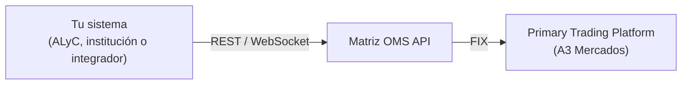

**Matriz OMS API** es una solución creada para facilitar la interoperabilidad de software de terceros con la plataforma de negociación electrónica de **A3 Mercados**, **Primary Trading Platform (PTP)**.

Simplifica la integración con la plataforma traduciendo las interfaces basadas en el estándar **FIX** a un conjunto de Web Services simplificados (**REST** y **WebSocket**), lo que reduce el esfuerzo y el costo de desarrollo.

## Qué podés hacer con la API

<CardGroup cols={2}>
  <Card title="Datos de referencia" icon="layer-group" href="/reference-data/segments/list">
    Consultá los segmentos de negociación y los instrumentos disponibles: listados, detalle, filtros por código CFI y por segmento.
  </Card>
  <Card title="Ruteo de órdenes" icon="paper-plane" href="/order-routing/new-order">
    Ingresá, reemplazá y cancelá órdenes, y consultá su estado por Client Order ID, cuenta o Execution ID.
  </Card>
  <Card title="Market Data" icon="chart-line" href="/market-data/snapshot">
    Obtené el último dato de mercado disponible de cualquier instrumento y consultá la historia de operaciones.
  </Card>
  <Card title="API WebSocket" icon="bolt" href="/websockets/overview">
    Operá de forma asíncrona: enviá órdenes, recibí Execution Reports y suscribite a Market Data en tiempo real sin hacer polling.
  </Card>
</CardGroup>

## REST o WebSocket

Ambas interfaces conviven y se complementan. Elegí según el tipo de interacción que necesites:

| | API REST | API WebSocket |
| --- | --- | --- |
| **Modelo** | Sincrónico: request y respuesta | Asíncrono: mensajes en ambos sentidos |
| **Datos de referencia** | Segmentos e instrumentos | — |
| **Órdenes** | Ingresar, reemplazar, cancelar y consultar estado | Ingresar, cancelar y suscribirse a Execution Reports (una cuenta, varias o todas) |
| **Market Data** | Último dato disponible al momento del request e historia de operaciones | Suscripción en tiempo real |

<Info>
  Las **cotizaciones en tiempo real requieren consumo vía WebSocket**. La API REST devuelve el último dato disponible al momento del request.
</Info>

## Mercados y segmentos

La operatoria está organizada en **segmentos**: los distintos ambientes o ruedas de negociación de **A3 Mercados** y **BYMA**, como `DDF`, `DDA`, `DUAL` y `MERV`, entre otros. Consultá el listado completo con [Lista de segmentos disponibles](/reference-data/segments/list).

Los **instrumentos** se agrupan por tipo, identificado con el estándar **CFI Code**, y cada uno tiene características propias (tick size, tamaño mínimo y máximo, vencimiento, entre otras) que podés consultar en su [descripción detallada](/reference-data/instruments/detail).

## Por dónde empezar

<Steps>
  <Step title="Identificá tu ambiente">
    Armá la URL base de tu ambiente a partir de tu identificador de cliente y tu dominio. Ver [Ambientes](/environments).
  </Step>
  <Step title="Obtené tu token de acceso">
    Autenticate con tu usuario y contraseña para obtener un token válido por 24 horas. Ver [Autenticación](/authentication).
  </Step>
  <Step title="Hacé tu primer request">
    Seguí la [Guía rápida](/quickstart) para consultar segmentos, ingresar una orden y verificar su estado.
  </Step>
</Steps>

## Herramientas y recursos

Para facilitar las pruebas y la integración, el ecosistema de Matriz OMS API incluye:

- APIDoc (Swagger)
- Cliente WebSocket web
- Repositorio de GitHub
- Colección de Postman
- Guía de implementación de Market Data
- Guía de implementación de Market Data y Order Routing
- Guía de homologación y buenas prácticas
- Notebook de Google Colab (webinar)
- Buenas prácticas de consumo

También hay webinars que explican las funcionalidades de la API y las herramientas creadas para facilitar las pruebas. Encontrá todos los accesos en [Herramientas del ecosistema](/resources/ecosystem) y [Webinars](/resources/webinars).

{/* [PENDIENTE] Agregar links directos a cada herramienta cuando estén actualizados (nota 📝 del manual). No usar los links del hub anterior. */}

## Soporte

Las consultas y los incidentes se gestionan mediante un **ticket en JIRA**, cargado a través del cliente que lo solicita. Más información en [Soporte](/support).
