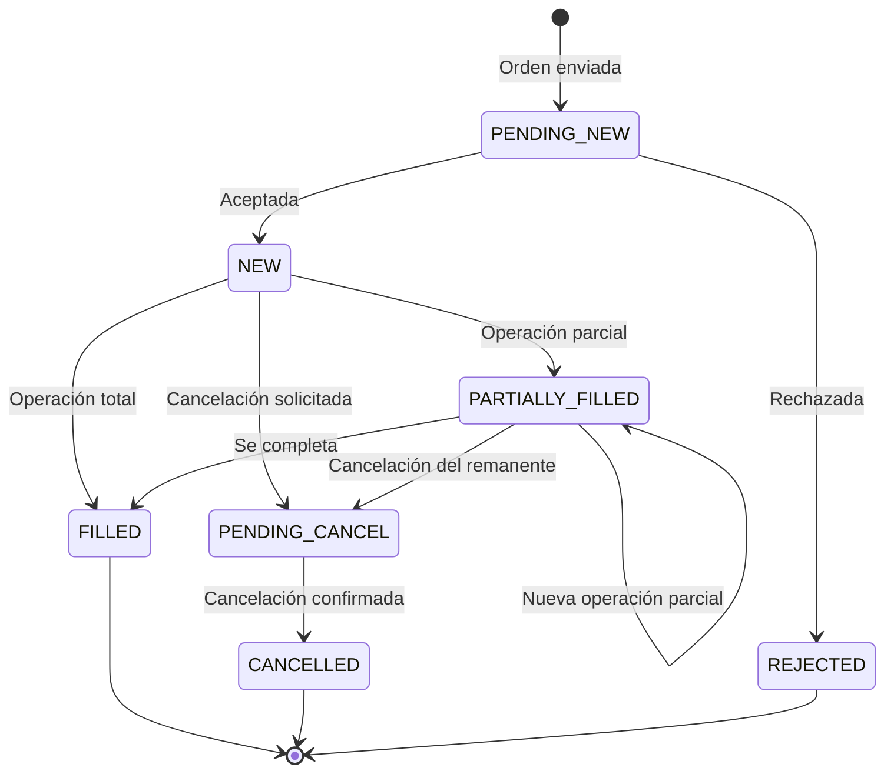

import RevisarVigencia from '/snippets/revisar-vigencia.mdx';

El campo `status` de una orden indica en qué estado se encuentra. Lo vas a encontrar en las [consultas de estado REST](/order-routing/status/last-by-client-order-id) y en los [Execution Reports](/websockets/orders/execution-report-message) (mensaje `or`) de la API WebSocket.

<Info>
  No confundas el `status` del **request** (`OK` / `ERROR`, en la raíz de la respuesta REST) con el `status` de la **orden** (dentro de `order`, `orders[]` u `orderReport`).
</Info>

## Estados posibles

| Estado | Significado | ¿Activa? | ¿Final? |
| --- | --- | --- | --- |
| `PENDING_NEW` | Enviada, pendiente de aceptación por el mercado. `orderId` puede llegar en `null`. | — | No |
| `NEW` | **Aceptada** por el mercado, en el book sin operar. | Sí | No |
| `PARTIALLY_FILLED` | **Operada parcialmente**; el remanente (`leavesQty`) sigue en el book. | Sí | No |
| `FILLED` | **Operada totalmente**. | No | Sí |
| `CANCELLED` | **Cancelada**. El motivo viene en `text` (ej.: `Cancelada`, `Reemplazada`). | No | Sí |
| `REJECTED` | **Rechazada**. El motivo viene en `text` y `orderId` llega en `null`. | No | Sí |
| `REPLACED` | Reemplazada. | No | — |
| `PENDING_CANCEL` | Cancelación solicitada, pendiente de confirmación. | — | No |
| `PENDING_REPLACE` | Reemplazo solicitado, pendiente de confirmación. | — | No |
| `PENDING_APPROVAL` | Pendiente de aprobación. | — | No |

Las órdenes **activas** son las que están en estado `NEW` o `PARTIALLY_FILLED`: son las que devuelve [Órdenes activas por cuenta](/order-routing/status/actives-by-account) y las que filtra `snapshotOnlyActive` en la [suscripción a Execution Reports](/websockets/orders/subscribe-execution-reports).

{/* [REVISAR_VIGENCIA] origen: Anexo Diccionario del PDF v1.21 (p. 51) para PENDING_CANCEL, PENDING_REPLACE y PENDING_APPROVAL. Los demás estados figuran en el manual vigente. */}
<RevisarVigencia dato="Los estados PENDING_CANCEL, PENDING_REPLACE y PENDING_APPROVAL" />

{/* [PENDIENTE] Confirmar: (1) en qué casos se usa PENDING_APPROVAL; (2) si REPLACED es un estado final o se informa junto con la nueva versión de la orden; (3) si la expiración de órdenes DAY y GTD al cierre se informa como CANCELLED o con otro estado. */}

## Ciclo de vida típico

El diagrama muestra las transiciones más habituales. Es ilustrativo: no incluye todos los estados intermedios posibles.

## Estados y Client Order ID

Cada request (alta, reemplazo, cancelación) tiene su propio **Client Order ID**, y cada estado queda asociado al request que lo generó:

- El historial del request de **alta** muestra estados como `PENDING_NEW`, `NEW`, `PARTIALLY_FILLED` y `FILLED`, pero **no** `CANCELLED`.
- El estado `CANCELLED` queda asociado al Client Order ID del request de **cancelación**.

Por eso, para confirmar una cancelación, consultá el estado con el `clientId` que devolvió la cancelación. Ver [Client Order ID vs. Order ID](/guides/client-order-id-vs-order-id).

{/* [REVISAR_VIGENCIA] origen: PDF v1.21, pp. 28-29 (exclusión de CANCELLED del historial del request de alta). */}
<RevisarVigencia dato="La asociación del estado CANCELLED al request de cancelación" />

## Campos para seguir la ejecución

| Campo | Qué indica |
| --- | --- |
| `orderQty` | Tamaño total de la orden. |
| `cumQty` | Cantidad operada acumulada. |
| `leavesQty` | Cantidad remanente pendiente de operar. |
| `lastQty` / `lastPx` | Cantidad y precio de la última operación. |
| `avgPx` | Precio promedio operado. |
| `text` | Motivo del estado (rechazo, cancelación, reemplazo). |
